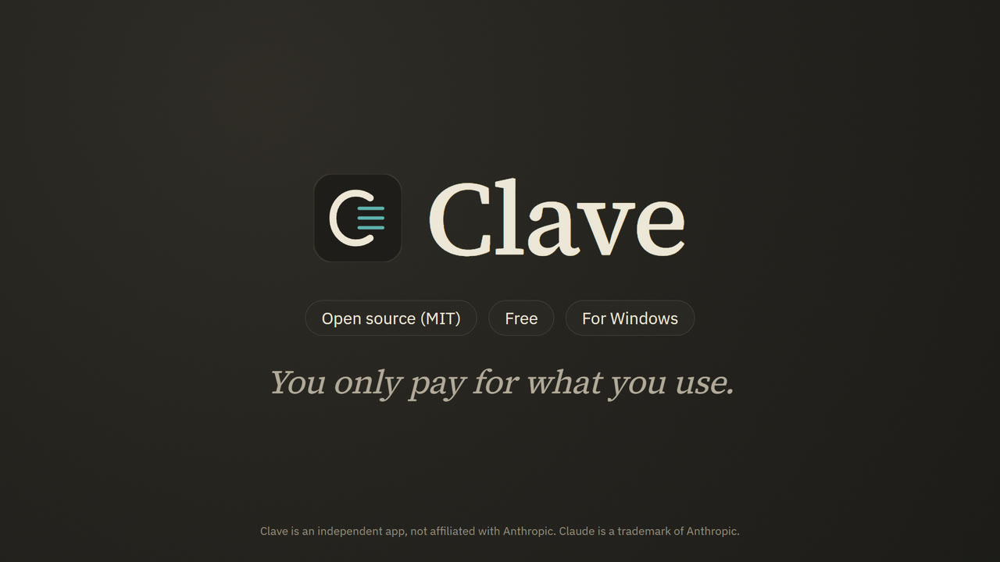
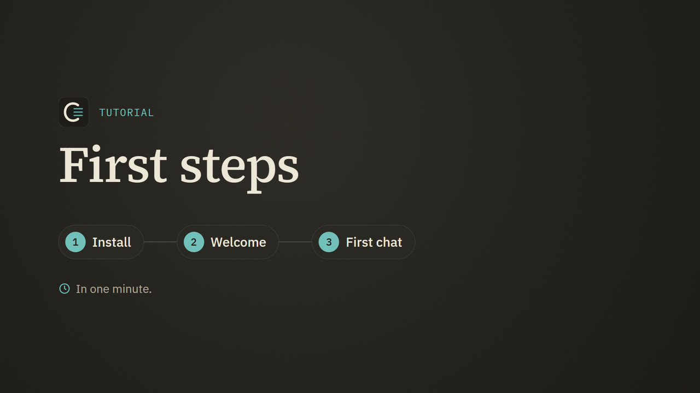
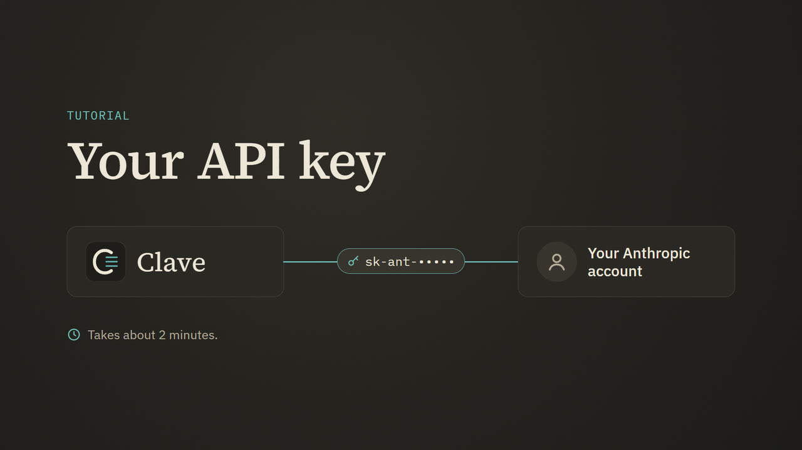
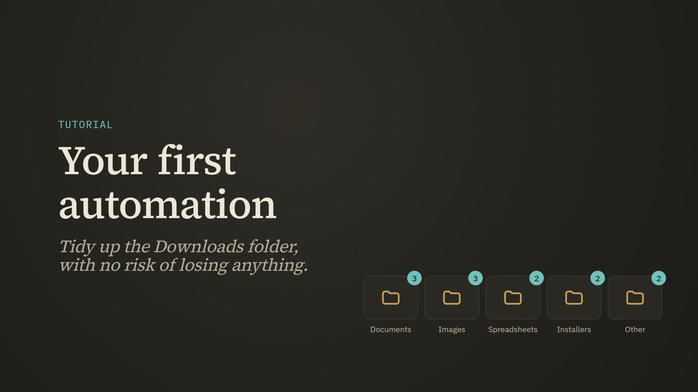

# Clave

**English** · [Português](README.pt-BR.md)

A Windows app that uses **Claude**, Anthropic's artificial intelligence, through
the **API**, with your own key. Similar to the official Claude app, but
pay-as-you-go and with a spending cap that you set.

> Clave is an independent app. It is not an Anthropic product and has no
> affiliation with Anthropic. "Claude" is a trademark of Anthropic.

## Why you should use Clave

**[Watch the video: why use Clave](https://github.com/FelipeWASD83/clave/releases/download/videos/por-que-o-clave.en.mp4)**
(1 min 27 s; also [in Brazilian Portuguese](https://github.com/FelipeWASD83/clave/releases/download/videos/por-que-o-clave.pt-BR.mp4))

**You pay for what you use, not a monthly fee.** The Claude Pro subscription
costs $20 a month, whether you use it a lot or a little. Through the API, each
reply costs what it used: a thousand short messages on Haiku 5.5 come to around
**$0.40**; on Sonnet 5.5, about $7 (estimates, without long reasoning). If you
use AI a few times a day, you spend cents, and Clave shows the cost of each
reply in real time.

**No more "you've hit your limit, come back in 5 hours."** The app's plans have
a limit per 5-hour window and a weekly limit. The API has no 5-hour window and
no weekly limit: the limit is requests per minute, which is plenty for one
person. You are the one in charge of your spending: Clave has a **monthly cap**
and stops when it reaches it. No surprises on the bill.

**Your data is yours.** By default, Anthropic **does not use what goes through
the API to train models** and deletes it from its servers within 30 days
([official
policy](https://privacy.claude.com/en/articles/7996866-how-long-do-you-store-my-organization-s-data)).
Your conversations, memory and history stay **only on your computer**, the key
is encrypted by Windows and Clave's code is open: you can read every line.

**The best model for each task, in the same window.** Haiku for the simple
things (fast and very cheap), Sonnet for everyday work, Opus for the hard
problems. And with **workflows**, the three work together on the same task:
Opus plans, Sonnet does the work, Haiku checks it, and you see the estimated
price before approving.

**Real automation on your Windows.** In Code mode, Claude works in a folder of
yours: it organizes files, builds spreadsheets with formulas and charts, writes
scripts and runs commands, always showing the before and after, with an undo
button and you deciding what it may do on its own. **Routines** make Claude work
on a schedule, even with the app closed.

**Made for people who have never used AI.** Short lessons in plain language, a
glossary without jargon ("who is Jason?" turns into an explanation of JSON) and
a helper that answers questions about each lesson for a fraction of a cent.

**What you learn here carries over to Claude Code.** CLAUDE.md, skills, agents,
commands, plugins and permission rules use the same files and the same format.
When you want to move to the professional tool, you already know everything.

**Already on Max?** The Max plan gives you monthly API credit ($100 on Max 5x,
$200 on Max 20x), and Clave uses that credit. It is money you already paid.

### And when the official app is better

No sugarcoating: if you want Claude **on your phone** or synced across several
devices, the official app does that and Clave doesn't (it is for Windows). And
someone who uses Opus all day, every day, may spend more through the API than on
the subscription. Clave shows how much you spend per day and per model on the
Usage & spend page, so after a month you know which of the two is cheaper for
you.

## What it does

- **Chat** with Claude: conversations, projects, attachments (images, PDFs,
  spreadsheets, text), versions of each reply, preview of HTML pages and SVG
  drawings.
- **Code mode**: Claude works in a folder on your computer, reads and creates
  files, edits spreadsheets and runs commands to automate tasks. You approve
  each change (or allow everything at once), see the before and after, and can
  undo.
- **The Code panel**, beside the conversation: **Files** (the folder as a tree,
  with search, rename and the Recycle Bin), a **Viewer** (code, Markdown, PDF,
  spreadsheets, Word, images, audio and video, and what Claude changed), a real
  PowerShell **Console** (a command from Claude's reply goes there with one
  click, and the output goes back to Claude), a **Browser** and **Tasks**.
- **A browser you share with Claude**: in Code mode it opens and reads pages and
  takes screenshots and, with your OK, clicks and types, to check what it built
  on a local server or to use a site. The servers running on your computer open
  with one click.
- **Background tasks**: local servers that Claude leaves running, replies,
  workflows, routines and downloads in one list, with the log and a Stop button.
- **Widgets**: in chat and in Code, Claude draws the answer as a card: products
  and prices, maps, recommendations, floor plans and drawings, charts,
  comparisons, timelines and checklists.
- **Workflows**: a big task becomes steps, each on the right model (Opus plans,
  Sonnet does the work and tests it, Haiku checks it), with steps running in
  parallel. A workflow costs more, so it **always asks for your OK** first,
  showing the steps, the cost estimate and a cap that you can adjust.
- **Agents**: ready-made specialists (planejador, executor, testador, revisor,
  pesquisador and redator: planner, executor, tester, reviewer, researcher and
  writer) and the ones you create, in the Claude Code format.
- **Permission rules**, in the Claude Code format (`Bash(npm test *)`,
  `Edit(docs/**)`...): what it does on its own, what it always asks about and
  what it never does, across the whole app or in a single folder, with a test
  and a history of every decision.
- **Plan mode**: it only reads, presents the plan on a card and you approve it,
  choosing how it executes.
- **Plugins and slash commands**: eight ready-made plugins with 31 skills
  (Excel, email, sales, research with sources, Windows scripts, tests...), installing
  plugins from GitHub in the Claude Code format, and shortcuts like
  `/model haiku`, `/workflow` and `/writing:email`.
- **Routines**: requests that Claude carries out on its own on a schedule
  (every day, on some days of the week, every few hours), even with Clave
  closed, through the Windows Task Scheduler.
- **Pricing & plans**: the price of each model and the "API or subscription?"
  calculation, which estimates what your use of regular Claude would cost on the
  API.
- **Your usage** panel on the new conversation screen: tokens, streak of days,
  heat map, favorite model, the last 7 days and the projection of when the
  month's cap runs out.
- **Environments in Code**, as in the official app, and **suggesting another
  conversation**: Claude proposes a separate job on a card, and it only opens
  when you click.
- **Excel**: reads, creates and edits spreadsheets (formulas, formatting,
  tables, charts, filters, dropdown lists). With Excel installed, it recalculates
  and exports PDF.
- **Models and reasoning**: Opus 5.5, Sonnet 5.5, Haiku 5.5 and Fable 5.1, with
  the reasoning level from Low to Max, visible reasoning and fast mode.
- **New model card**: when Anthropic releases a model, a card shows what it is,
  what changed, its price next to the others and an intelligence score for all
  of them on the same scale, with the source.
- **Personalization**: "about you", "how to respond", ready-made styles and your
  own, projects with instructions and pinned files, and the **way of talking**
  (like ChatGPT's tone controls: base tone, warmth, enthusiasm, emoji, headers and
  lists, simple or technical language), with an example before you use it.
- **Memory** across conversations, in text files by topic that you can see, edit
  and delete, with a memory editor that changes whatever you ask.
- **Monthly spending cap**, spend per reply, per day, per model and per
  conversation, and the gauge that shows how much of the conversation's memory
  has been used.
- **GitHub**: attach files from your repositories and let Claude look up code,
  issues and pull requests.
- **Web search**, on by default (Claude decides when to search and shows the
  sources), and **MCP connectors**.
- **E-mail, Word and Zapier**: Claude reads your e-mail (Gmail, other providers
  or the classic Outlook) and writes replies that only go out with your OK,
  creates Word documents and exports PDF, and reaches Google, Microsoft,
  WhatsApp and hundreds of apps through a guided Zapier connection.
- **Import from Claude or ChatGPT**: bring your rules, projects, preferences and
  routines with one copy and paste.
- **Saves your credit**: it starts on Haiku, the cheapest model, and a **model
  advisor** (Haiku itself, at the first message and every 5) suggests the model
  that does the task for the lowest price, or switches on its own if you allow it.
  Plus /compact, /savings and a program without AI instead of a routine for work
  that always repeats.
- **Commands in English and Portuguese**: every command, skill and workflow that
  comes with Clave works with both names (/summary or /resumo, /sales:proposal or
  /vendas:proposta), and the menu shows the one in your language.

- **Learn**: lessons for people who have never used AI, in nine tracks (first
  steps, making Claude yours, automation with Code mode, going further, saving
  credit, the Code workspace, visual answers, using it safely and recipes by
  area), with a glossary of terms (API, JSON, Git...), short videos and a helper
  that answers questions about each lesson.
- **Guided tours**: the first time, arrows point to each part of the screen and
  explain what it does.
- **English and Brazilian Portuguese**: the interface, the lessons, the folder
  template and the built-in plugins, in either language.
- **Folder template**: a ready-made working folder, with rules (CLAUDE.md),
  skills (including watching videos) and visual references for websites.
- **Update button**: downloads the new version from this repository and
  restarts.

## What you need

- Windows 10 or 11.
- Internet.
- An Anthropic account with API credit (see below). Anyone who subscribes to
  Claude's Max plan gets monthly API credit.

## Install

1. Download this repository: the green **Code > Download ZIP** button on GitHub,
   or the newest version under **Releases**.
2. Extract the ZIP into a folder of yours (for example, `Documents\Clave`).
3. Double-click **`instalar.bat`**. It:
   - looks for Python 3.10 or newer and, if it can't find it, offers to install
     it through winget;
   - creates Clave's environment and installs the dependencies;
   - downloads the official Electron (the app window, about 110 MB), checked
     against the SHA-256 checksums published with it;
   - creates the **Clave** shortcuts on the desktop and in the Start menu.
4. Open it from the **Clave** shortcut.

The first time, Clave asks for your API key and the spending cap for the month.

Clave speaks English and Brazilian Portuguese. On the first run it picks the
language that Windows is set to; to change it, go to Settings > Appearance.

### How to get the API key

1. Go to **platform.claude.com** (the Anthropic Console) and create an account.
2. Add credit under **Billing** (or, if you subscribe to Max, turn on the plan's
   credit in claude.ai > Settings > Billing > API credits).
3. Under **API Keys**, click **Create Key** and copy the key (`sk-ant-...`).
4. Paste it into Clave when it asks (or in Settings > Account & key).

The key is stored only on your computer, encrypted by Windows.

## Videos

Short narrated videos, in English and in Brazilian Portuguese. They also play inside Clave, in the
lessons (**Learn**): Clave downloads the ones in its language in the background (about 28 MB) and the
lesson plays them from your computer. They are not part of Clave's download; to download them only
when you press play, turn it off in Settings > Updates & about.

| Video | What it shows |
|---|---|
|  | **[First steps](https://github.com/FelipeWASD83/clave/releases/download/videos/primeiros-passos.en.mp4)** (1 min 10 s): installing, the welcome window, the first chat, the model button and what an answer costs. [Em português](https://github.com/FelipeWASD83/clave/releases/download/videos/primeiros-passos.pt-BR.mp4) (1 min 10 s). |
|  | **[Your API key](https://github.com/FelipeWASD83/clave/releases/download/videos/chave-da-api.en.mp4)** (1 min 24 s): creating the account in the Anthropic Console, adding credit, creating the key, pasting it into Clave and the monthly cap. [Em português](https://github.com/FelipeWASD83/clave/releases/download/videos/chave-da-api.pt-BR.mp4) (1 min 22 s). |
|  | **[Your first automation](https://github.com/FelipeWASD83/clave/releases/download/videos/primeira-automacao.en.mp4)** (1 min 16 s): Code mode sorting the Downloads folder: the plan first, the approval card and checking the result. [Em português](https://github.com/FelipeWASD83/clave/releases/download/videos/primeira-automacao.pt-BR.mp4) (1 min 17 s). |

## How much it costs

You pay Anthropic for what you use, by number of tokens. Approximate examples: a
short question on Haiku 5.5 costs less than $0.001; an average reply on Sonnet
5.5, about $0.01; a big task in Code mode, from cents to a few dollars. Clave
shows the cost of each reply and stops when the month reaches the cap you set.

## Privacy and security

- The messages and files you send go to Anthropic (that is how Claude answers).
  Your conversations, memory, projects and spending history stay **only on your
  computer**, in Clave's `dados` folder.
- Clave only accepts connections from the computer itself, and every request
  needs the session that the shortcut creates: no web page on the internet can
  tell Claude to touch your files.
- In Code mode, changing files and running commands asks for your OK (you can
  adjust this with the permission mode and with rules). Commands that delete or
  publish something **always** ask, unless a rule of yours allows that command,
  and Plan mode changes nothing. Sensitive files go on the protected list: the
  file tools never touch them, and a command that mentions them asks for an OK.
- The browser in Code mode keeps its own cookies and logins, apart from the
  rest of Clave. Outside Auto mode, Claude asks before using each new site in a
  task and before every click or typing; it never types passwords, access codes
  or card numbers, and it treats what a page says as data, never as orders. Sign
  out deletes the browser's data.
- Photos in widgets come from other sites, so they only load when you click
  (a page could use a photo's address to carry data out). Maps come from
  OpenStreetMap through Clave.
- Workflows always ask for your OK. Routines never ask: they only do what your
  rules already allow and stop at the rest.
- Plugins bring instructions for Claude: install them only from people you
  trust. Clave shows the content before installing and ignores the parts that
  would run programs on their own (hooks and local MCP servers).

## Updating

Clave checks for a new version once a day. When there is one, an **Update**
button appears in the left bar: it shows what changed, downloads, keeps the
current version (and goes back to it if the new one doesn't open) and restarts.
Your data is not touched.

## Smart App Control (Windows 11)

Windows 11's Smart App Control blocks new programs that have no signature. Clave
has no executable of its own on purpose: it runs on the official Python and the
official Electron, which Windows recognizes. If an "Application Control" warning
still appears while installing the dependencies, try again later or open an
issue here with the name of the blocked file.

## Uninstall

In **Settings > Updates & about > Uninstall**: Clave closes and deletes its
folder, the shortcuts and the routines' tasks in the Task Scheduler. The
conversations live inside the folder, so download the backup first (Settings >
Data & backup) if you want to keep them. By hand: delete Clave's folder and the
two shortcuts.

**Sign out** (same place) deletes the key, the saved passwords and the logins
and cookies of the Code browser, and sets every setting back to default, keeping
your conversations.

## For developers

- `servidor/`: local server in Python (standard library + the official
  `anthropic` SDK + `openpyxl`). `servidor/servidor.py --demo --sem-senha` starts
  a demo with a fake API, spending nothing.
- `app/`: the interface (HTML, CSS and JavaScript with no build step).
- `electron/`: the app window.
- `tutoriais/`: the lessons, in Markdown.
- `modelo-de-pasta/`: the working folder template.
- `skills/`: skills that ship with Clave (ver-video).
- `plugins/`, `agentes/`, `fluxos/`: plugins, agents and workflows that ship with
  Clave (the formats are Claude Code's; the workflows are Clave `.json` files).
- Tests: `.venv\Scripts\python.exe -m unittest discover -s testes -t testes`.
- Publishing a version: `ferramentas\publicar-versao.ps1` (creates the GitHub
  release that the Update button downloads).

The code's identifiers and comments are in Portuguese on purpose; the app itself
is bilingual (Brazilian Portuguese and English).

Technical details and decisions in [`CLAUDE.md`](CLAUDE.md). History in
[`CHANGELOG.md`](CHANGELOG.md).

## License

Clave's code is free software, under the [MIT](LICENSE) license. The libraries
and fonts in `app/vendor/` (including xterm.js and Leaflet) have their own
licenses, in the file next to each one. Map data © OpenStreetMap contributors.
The screenshots in `modelo-de-pasta/.claude/referencias-visuais/prints/` are
captures of public websites, kept only as a study reference; the sites and the
brands belong to their owners.
