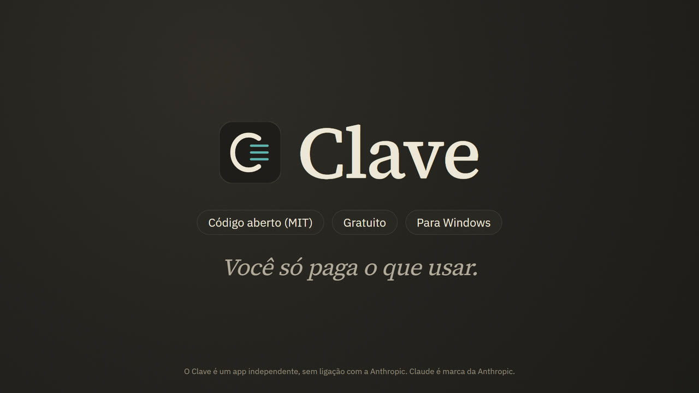
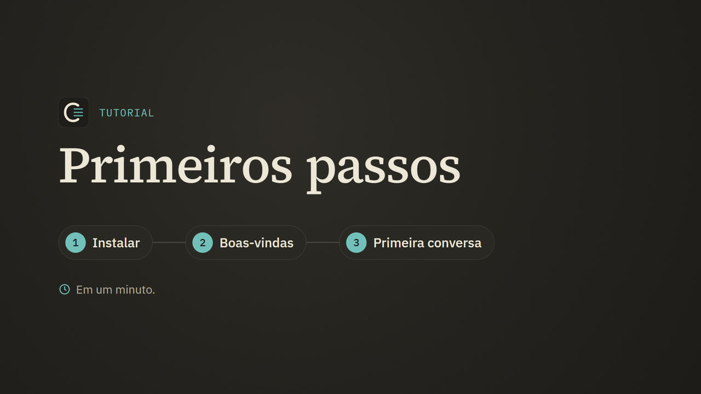
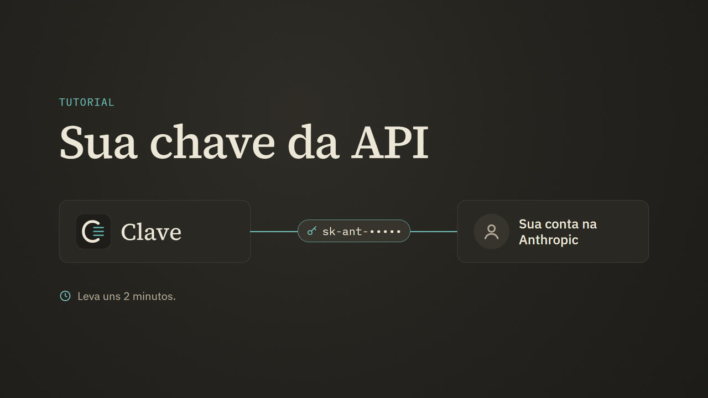
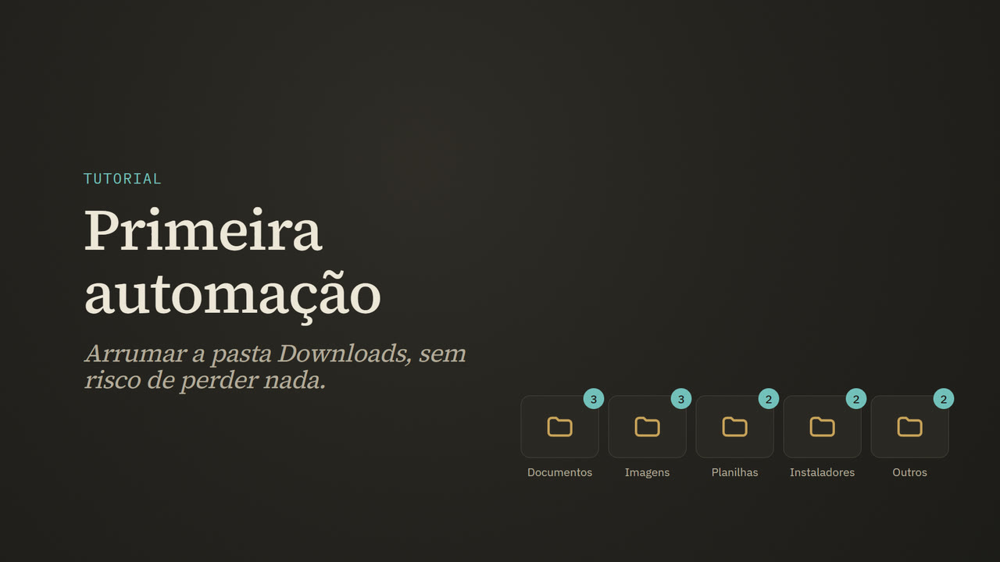

# Clave

[English](README.md) · **Português**

Um app para Windows que usa o **Claude**, a inteligência artificial da Anthropic,
pela **API**, com a sua própria chave. Parecido com o app do Claude, mas pago por
uso e com um teto de gasto que você define.

> O Clave é um app independente. Ele não é um produto da Anthropic e não tem
> ligação com ela. "Claude" é marca da Anthropic.

## Por que você deveria usar o Clave

**[Assista ao vídeo: por que usar o Clave](https://github.com/FelipeWASD83/clave/releases/download/videos/por-que-o-clave.pt-BR.mp4)**
(1 min 27 s; também [em inglês](https://github.com/FelipeWASD83/clave/releases/download/videos/por-que-o-clave.en.mp4))

**Você paga pelo que usa, não por uma mensalidade.** A assinatura Pro do
Claude custa US$ 20 por mês, use você muito ou pouco. Pela API, cada resposta
custa o que gastou: mil mensagens curtas no Haiku 5.5 saem por volta de
**US$ 0,40**; no Sonnet 5.5, uns US$ 7 (estimativas, sem raciocínio longo). Quem
usa a IA algumas vezes por dia gasta centavos, e o Clave mostra o custo de cada
resposta, em tempo real.

**Nunca mais "você atingiu o limite, volte em 5 horas".** Os planos do app têm
limite por janela de 5 horas e limite semanal. Na API não existe janela de 5
horas nem limite semanal: o limite é de pedidos por minuto, folgado para uma
pessoa. Quem manda no seu gasto é você: o Clave tem um **teto mensal** e para
quando chega nele. Sem susto na fatura.

**Seus dados são seus.** Por padrão, a Anthropic **não usa o que passa pela
API para treinar modelos** e apaga do servidor dela em até 30 dias ([política
oficial](https://privacy.claude.com/en/articles/7996866-how-long-do-you-store-my-organization-s-data)).
As conversas, a memória e o histórico ficam **só no seu computador**, a chave
fica criptografada pelo Windows e o código do Clave é aberto: dá para ler cada
linha.

**O melhor modelo para cada tarefa, na mesma janela.** Haiku para o simples
(rápido e baratíssimo), Sonnet para o dia a dia, Opus para o difícil. E com os
**fluxos**, os três trabalham juntos na mesma tarefa: o Opus planeja, o Sonnet
faz, o Haiku confere, e você vê o preço estimado antes de aprovar.

**Automação de verdade no seu Windows.** No modo Code o Claude trabalha numa
pasta sua: organiza arquivos, monta planilhas com fórmula e gráfico, escreve
scripts e roda comandos, sempre mostrando o antes e o depois, com botão de
desfazer e você decidindo o que ele pode fazer sozinho. As **rotinas** fazem o
Claude trabalhar no horário, até com o app fechado.

**Feito para quem nunca usou IA.** Lições curtas em português, glossário sem
tecniquês ("quem é JASON?" vira uma explicação de JSON) e um ajudante
que tira dúvida de cada lição por uma fração de centavo.

**O que você aprende aqui vale no Claude Code.** CLAUDE.md, skills, agentes,
comandos, plugins e regras de permissão usam os mesmos arquivos e o mesmo
formato. Quando quiser ir para a ferramenta profissional, já sabe tudo.

**Já assina o Max?** O plano Max dá crédito mensal na API (US$ 100 no Max 5x,
US$ 200 no Max 20x), e o Clave usa esse crédito. É dinheiro que você já pagou.

### E quando o app oficial é melhor

Sem enrolação: se você quer o Claude **no celular** ou sincronizado entre
vários aparelhos, o app oficial faz isso e o Clave não (ele é para Windows). E
quem usa o Opus o dia inteiro, todo dia, pode gastar mais pela API do que na
assinatura. O Clave mostra quanto você gasta por dia e por modelo na página de
uso, então em um mês você sabe qual dos dois sai mais barato para você.

## O que ele faz

- **Chat** com o Claude: conversas, projetos, anexos (imagens, PDFs, planilhas,
  textos), versões de cada resposta, prévia de páginas HTML e desenhos SVG.
- **Modo Code**: o Claude trabalha numa pasta do seu computador, lê e cria
  arquivos, mexe em planilhas e roda comandos para automatizar tarefas. Você
  aprova cada mudança (ou libera de vez), vê o antes e depois e pode desfazer.
- **O painel do Code**, ao lado da conversa: **Arquivos** (a pasta em árvore,
  com busca, renomear e Lixeira), um **Visualizador** (código, Markdown, PDF,
  planilhas, Word, imagens, áudio e vídeo, e o que o Claude mudou), um
  **Console** com PowerShell de verdade (um comando da resposta do Claude vai
  para lá com um clique, e a saída volta para o Claude), um **Navegador** e
  **Tarefas**.
- **Um navegador que você divide com o Claude**: no modo Code ele abre e lê
  páginas e tira print e, com o seu OK, clica e digita, para conferir o que
  construiu num servidor local ou usar um site. Os servidores rodando no seu
  computador abrem com um clique.
- **Tarefas em segundo plano**: servidores locais que o Claude deixa rodando,
  respostas, fluxos, rotinas e downloads numa lista só, com o registro e um
  botão Parar.
- **Widgets**: no chat e no Code, o Claude desenha a resposta num cartão:
  produtos e preços, mapas, recomendações, plantas e desenhos, gráficos,
  comparações, linhas do tempo e listas para marcar.
- **Fluxos**: uma tarefa grande vira etapas, cada uma no modelo certo (o Opus
  planeja, o Sonnet faz e testa, o Haiku confere), com etapas em paralelo.
  Fluxo gasta mais, então ele **pede o seu OK** antes (menos no modo Livre), mostrando as
  etapas, a estimativa de custo e um teto que você ajusta.
- **Agentes**: especialistas prontos (planejador, executor, testador, revisor,
  pesquisador, redator) e os que você criar, no formato do Claude Code.
- **Permissões por regras**, no formato do Claude Code (`Bash(npm test *)`,
  `Edit(docs/**)`...): o que ele faz sozinho, o que sempre pergunta e o que
  nunca faz, no app inteiro ou numa pasta, com teste e histórico de cada
  decisão.
- **Modo Plano**: ele só lê, apresenta o plano num cartão e você aprova
  escolhendo como ele executa.
- **Plugins e comandos de barra**: oito plugins prontos com 31 skills
  (Excel, e-mail, vendas, pesquisa com fontes, scripts do Windows, testes...),
  instalação de plugins do GitHub no formato do Claude Code, e atalhos como
  `/modelo haiku`, `/fluxo` e `/escrita:email`.
- **Rotinas**: pedidos que o Claude faz sozinho no horário (todo dia, em
  alguns dias da semana, a cada poucas horas), até com o Clave fechado, pelo
  Agendador de Tarefas do Windows.
- **Preços e planos**: o preço de cada modelo e a conta "API ou assinatura?",
  que estima quanto o seu uso do Claude normal custaria na API.
- **Painel de uso** na conversa nova: tokens, dias seguidos, mapa de calor,
  modelo favorito, os últimos 7 dias e a projeção de quando o teto do mês acaba.
- **Ambientes no Code**, como no app oficial, e **sugestão de outra
  conversa**: o Claude propõe um trabalho separado num cartão e ele só abre com
  o seu clique.
- **Excel**: lê, cria e altera planilhas (fórmulas, formatação, tabelas,
  gráficos, filtros, listas de opção). Com o Excel instalado, recalcula e
  exporta PDF.
- **Modelos e raciocínio**: Opus 5.5, Sonnet 5.5, Haiku 5.5 e Fable 5.1, com o
  nível de raciocínio de Baixo a Máximo, raciocínio visível e modo rápido.
- **Cartão de modelo novo**: quando a Anthropic lança um modelo, um cartão mostra
  o que ele é, o que mudou, o preço ao lado dos outros e a nota de inteligência
  de todos na mesma régua, com a fonte.
- **Personalização**: "sobre você", "como responder", estilos prontos e seus,
  projetos com instruções e arquivos fixos, e o **jeito de falar** (como o
  controle de tom do ChatGPT: tom básico, cordialidade, entusiasmo, emoji,
  títulos e listas, linguagem simples ou técnica), com um exemplo antes de usar.
- **Memória** entre conversas, em arquivos de texto por assunto que você vê,
  edita e apaga, com um editor de memória que muda o que você pedir.
- **Teto de gasto** mensal, gasto por resposta, por dia, por modelo e por
  conversa, e a régua que mostra quanto da memória da conversa já foi usada.
- **GitHub**: anexar arquivos dos seus repositórios e deixar o Claude consultar
  código, issues e pull requests.
- **Busca na web**, ligada por padrão (o Claude decide quando pesquisar e mostra
  as fontes), e **conectores MCP**.
- **E-mail, Word e Zapier**: o Claude lê o seu e-mail (Gmail, outros provedores
  ou o Outlook clássico) e escreve respostas que só saem com o seu OK, cria
  documentos do Word e exporta PDF, e chega no Google, na Microsoft, no WhatsApp
  e em centenas de apps por uma ligação guiada com o Zapier.
- **Importar do Claude ou do ChatGPT**: traga as suas regras, projetos,
  preferências e rotinas com um copiar e colar.
- **Economiza o seu crédito**: começa no Haiku, o modelo mais barato, e um
  **conselheiro de modelo** (o próprio Haiku, na primeira mensagem e a cada 5)
  sugere o modelo que faz a tarefa pelo menor preço, ou troca sozinho se você
  deixar. Mais /compact, /economia e um programa sem IA no lugar de rotina para
  trabalho que sempre se repete.
- **Comandos em português e inglês**: todo comando, skill e fluxo que vem com o
  Clave funciona com os dois nomes (/resumo ou /summary, /vendas:proposta ou
  /sales:proposal), e o menu mostra o do seu idioma.

- **Aprender**: lições para quem nunca usou IA, em nove trilhas (primeiros
  passos, deixar o Claude do seu jeito, automação com o modo Code, ir além,
  economizar crédito, a mesa do Code, respostas visuais, usar com segurança e
  receitas por área), com glossário de termos (API, JSON, Git...), vídeos curtos
  e um ajudante que tira dúvidas de cada lição.
- **Tours com setinhas**: na primeira vez, setas apontam cada parte da tela e
  explicam para que serve.
- **Português do Brasil e inglês**: a interface, as lições, o modelo de pasta e
  os plugins que vêm com o app, nos dois idiomas.
- **Modelo de pasta**: uma pasta de trabalho pronta, com regras (CLAUDE.md),
  skills (inclusive ver vídeos) e referências visuais para sites.
- **Botão Atualizar**: baixa a versão nova deste repositório e reinicia.

## Do que você precisa

- Windows 10 ou 11.
- Internet.
- Uma conta na Anthropic com crédito na API (veja abaixo). Quem assina o plano
  Max do Claude ganha crédito mensal na API.

## Instalar

1. Baixe este repositório: botão verde **Code > Download ZIP** no GitHub, ou a
   versão mais nova em **Releases**.
2. Extraia o ZIP numa pasta sua (por exemplo, `Documentos\Clave`).
3. Dê dois cliques em **`instalar.bat`**. Ele:
   - procura o Python 3.10 ou mais novo e, se não achar, oferece instalar pelo
     winget;
   - cria o ambiente do Clave e instala as dependências;
   - baixa o Electron oficial (a janela do app, uns 110 MB), conferido pelos
     SHA-256 publicados junto com ele;
   - cria os atalhos **Clave** na área de trabalho e no menu Iniciar.
4. Abra pelo atalho **Clave**.

Na primeira vez, o Clave pede a sua chave da API e o teto de gasto do mês.

O Clave fala português do Brasil e inglês. Na primeira vez ele usa o idioma do
Windows; para trocar, vá em Configurações > Aparência.

### Como conseguir a chave da API

1. Entre em **platform.claude.com** (o Console da Anthropic) e crie uma conta.
2. Ponha crédito em **Billing** (ou, se você assina o Max, ative o crédito do
   plano em claude.ai > Settings > Billing > API credits).
3. Em **API Keys**, clique em **Create Key** e copie a chave (`sk-ant-...`).
4. Cole no Clave quando ele pedir (ou em Configurações > Conta e chave).

A chave fica guardada só no seu computador, criptografada pelo Windows.

## Vídeos

Vídeos curtos e narrados, em português e em inglês. Eles também tocam dentro do Clave, nas lições
(**Aprender**): o Clave baixa os do idioma dele em segundo plano (uns 28 MB) e a lição toca do seu
computador. Eles não vêm no download do Clave; para baixar só quando você der play, desligue em
Configurações > Atualizações e sobre.

| Vídeo | O que mostra |
|---|---|
|  | **[Primeiros passos](https://github.com/FelipeWASD83/clave/releases/download/videos/primeiros-passos.pt-BR.mp4)** (1 min 10 s): instalar, a janela de boas-vindas, a primeira conversa, o botão do modelo e quanto custa uma resposta. [In English](https://github.com/FelipeWASD83/clave/releases/download/videos/primeiros-passos.en.mp4) (1 min 10 s). |
|  | **[Sua chave da API](https://github.com/FelipeWASD83/clave/releases/download/videos/chave-da-api.pt-BR.mp4)** (1 min 22 s): criar a conta no Console da Anthropic, colocar crédito, criar a chave, colar no Clave e o teto do mês. [In English](https://github.com/FelipeWASD83/clave/releases/download/videos/chave-da-api.en.mp4) (1 min 24 s). |
|  | **[Sua primeira automação](https://github.com/FelipeWASD83/clave/releases/download/videos/primeira-automacao.pt-BR.mp4)** (1 min 17 s): o modo Code organizando a pasta Downloads: o plano primeiro, o cartão de aprovação e conferir o resultado. [In English](https://github.com/FelipeWASD83/clave/releases/download/videos/primeira-automacao.en.mp4) (1 min 16 s). |

## Quanto custa

Você paga a Anthropic pelo que usar, por número de tokens. Exemplos aproximados:
uma pergunta curta no Haiku 5.5 custa menos de US$ 0,001; uma resposta média no
Sonnet 5.5, uns US$ 0,01; uma tarefa grande no modo Code, de centavos a alguns
dólares. O Clave mostra o custo de cada resposta e para quando o mês chega no
teto que você definiu.

## Privacidade e segurança

- As mensagens e os arquivos que você manda vão para a Anthropic (é assim que o
  Claude responde). As conversas, a memória, os projetos e o histórico de gasto
  ficam **só no seu computador**, na pasta `dados` do Clave.
- O Clave só aceita conexões do próprio computador, e cada pedido precisa da
  sessão que o atalho cria: nenhuma página da internet consegue mandar o Claude
  mexer nos seus arquivos.
- No modo Code, mudar arquivos e rodar comandos pede o seu OK (dá para ajustar
  com o modo e com regras). Comandos que apagam arquivos ou dados **sempre**
  pedem, até no modo Livre (a única coisa que ele ainda pergunta), a não ser que
  uma regra sua libere aquele comando. Publicar, mandar e-mail e mexer fora da
  pasta pedem nos outros modos, e o modo Plano não muda nada. Arquivos sensíveis vão para a lista de protegidos: as ferramentas
  de arquivo nunca mexem neles e comando que os cite pede OK.
- O navegador do modo Code guarda cookies e logins próprios, separados do resto
  do Clave. Fora do modo Livre, o Claude pergunta antes de usar cada site novo
  numa tarefa e antes de cada clique ou digitação; ele nunca digita senha,
  código de acesso nem número de cartão, e trata o que a página diz como dado,
  nunca como ordem. Sair da conta apaga os dados do navegador.
- Fotos dos widgets vêm de outros sites, então só carregam quando você clica
  (uma página poderia usar o endereço de uma foto para levar dados para fora).
  Os mapas vêm do OpenStreetMap pelo Clave.
- Fluxos pedem OK, menos no modo Livre. Rotinas nunca perguntam: só fazem o que as suas
  regras já liberam e param no resto.
- Plugins trazem instruções para o Claude: instale só de quem você confia. O
  Clave mostra o conteúdo antes de instalar e ignora as partes que rodariam
  programas sozinhas (hooks e servidores MCP locais).

## Atualizar

O Clave procura versão nova uma vez por dia. Quando houver, aparece o botão
**Atualizar** na barra da esquerda: ele mostra o que mudou, baixa, guarda a
versão atual (e volta para ela se a nova não abrir) e reinicia. Seus dados não
são tocados.

## Smart App Control (Windows 11)

O Smart App Control do Windows 11 bloqueia programas novos sem assinatura. O
Clave não tem executável próprio de propósito: ele roda no Python oficial e no
Electron oficial, que o Windows reconhece. Se mesmo assim aparecer um aviso de
"Controle de Aplicativo" ao instalar as dependências, tente de novo mais tarde
ou abra uma issue aqui com o nome do arquivo bloqueado.

## Desinstalar

Em **Configurações > Atualizações e sobre > Desinstalar**: o Clave fecha e apaga
a pasta dele, os atalhos e as tarefas das rotinas no Agendador. As conversas
moram dentro da pasta, então baixe o backup antes (Configurações > Dados e
backup) se quiser guardar. À mão: apague a pasta do Clave e os dois atalhos.

**Sair da conta** (no mesmo lugar) apaga a chave, as senhas salvas e os logins e
cookies do navegador do Code, e volta todas as configurações ao padrão, mantendo
as conversas.

## Para quem desenvolve

- `servidor/`: servidor local em Python (biblioteca padrão + SDK oficial
  `anthropic` + `openpyxl`). `servidor/servidor.py --demo --sem-senha` sobe uma
  demonstração com uma API de mentira, sem gastar nada.
- `app/`: a interface (HTML, CSS e JavaScript sem etapa de build).
- `electron/`: a janela do app.
- `tutoriais/`: as lições, em Markdown.
- `modelo-de-pasta/`: o modelo de pasta de trabalho.
- `skills/`: skills que vêm com o Clave (ver-video).
- `plugins/`, `agentes/`, `fluxos/`: plugins, agentes e fluxos que vêm com o
  Clave (os formatos são os do Claude Code; os fluxos são `.json` do Clave).
- Testes: `.venv\Scripts\python.exe -m unittest discover -s testes -t testes`.
- Publicar versão: `ferramentas\publicar-versao.ps1` (cria a release no GitHub
  que o botão Atualizar baixa).

Detalhes técnicos e decisões em [`CLAUDE.pt-BR.md`](CLAUDE.pt-BR.md). Histórico em
[`CHANGELOG.pt-BR.md`](CHANGELOG.pt-BR.md).

## Licença

O código do Clave é livre, sob a licença [MIT](LICENSE). As bibliotecas e
fontes em `app/vendor/` (inclusive o xterm.js e o Leaflet) têm as licenças delas,
no arquivo ao lado de cada uma. Dados dos mapas © colaboradores do
OpenStreetMap.
Os prints em `modelo-de-pasta/.claude/referencias-visuais/prints/` são capturas
de sites públicos, guardadas só como referência de estudo; os sites e as marcas
são dos donos deles.
